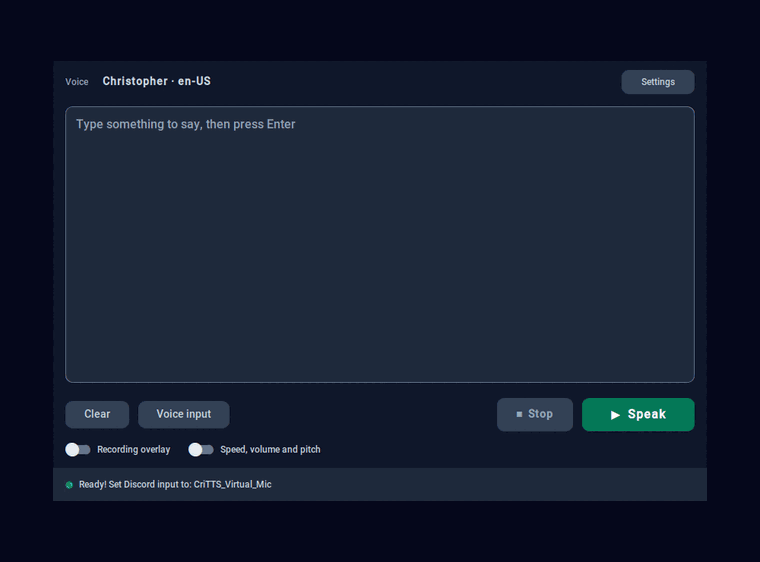

<p align="center">
  
</p>

<h1 align="center">CriTTS Recoded</h1>

<p align="center">Type to talk. A desktop text-to-speech app that speaks into Discord, VRChat or any other app as a microphone.</p>

<p align="center">
  
</p>

This is a personal project made for fun :)

## What it does

You type, CriTTS speaks. The audio can go to your speakers or to a virtual microphone, so people in a voice chat hear the voice you picked.

- Three speech engines: Microsoft Edge voices (online, free, no API key, 300+ voices), Piper (offline and fast) and Coqui XTTS v2 (offline, higher quality, needs a big first download).
- Speed, volume and pitch sliders, voice search with language, region and gender filters, favorite and recent voices.
- Optional automatic language detection that picks a matching voice for what you typed.
- Voice input: record from your microphone and turn it into text (Google Web Speech, needs internet), optionally spoken right away.
- Abbreviations (`brb` becomes "be right back"), a soundboard (`[1]` in your text plays a sound file), and custom keybinds, including system-wide hotkeys.
- VRChat over OSC: your text in the chatbox, a typing indicator while you write, and avatar lip-sync from the speech.
- A disk cache, so phrases you repeat play instantly.

## Install

You need:

- Python 3.10 or newer, with Tk. On Linux install it from your distro: `sudo pacman -S tk` (Arch), `sudo apt install python3-tk` (Debian/Ubuntu) or `sudo dnf install python3-tkinter` (Fedora).
- ffmpeg on your `PATH`. Edge voices arrive as MP3 and CriTTS decodes them with ffmpeg.
- On Linux, the PortAudio library (`libportaudio2` on Debian/Ubuntu, `portaudio` elsewhere).

Then clone the repository and start it with the launcher:

```bash
git clone https://github.com/crisbbc/CriTTS.git
cd CriTTS
./run.sh        # Linux / macOS
run.bat         # Windows
```

The launcher uses [uv](https://docs.astral.sh/uv/) when it is installed (it creates `.venv` and installs the locked dependencies from `uv.lock`) and falls back to a plain `venv` plus `pip` otherwise.

Without the launcher:

```bash
python -m venv .venv
source .venv/bin/activate        # Windows: .venv\Scripts\activate
pip install -r requirements.txt
python main.py
```

On Linux, uv is set to prefer your system Python (`python-preference = "system"` in `pyproject.toml`). The Pythons uv downloads ship a Tk without font smoothing, which makes the interface look pixelated.

## Using it

Type in the text box and press Enter or click **Speak**. Shift+Enter adds a new line. The header shows which voice will speak; click it to change the voice.

| Default shortcut | Action |
| --- | --- |
| `Enter` | Speak |
| `Escape` | Stop |
| `Ctrl+T` | Clear the text |
| `Ctrl+,` | Open Settings |
| `Ctrl+Shift+V` | Start or stop voice input |
| `Ctrl+Tab` / `Ctrl+Shift+Tab` | Next or previous Settings page |

Every shortcut except Enter and the Settings page keys can be changed in **Settings → Keybinds**. Turn on system-wide hotkeys there to use them while CriTTS is in the background.

The **Speed, volume and pitch** switch under the buttons shows or hides the sliders. The **Recording overlay** switch shows a small always-on-top window that tells you when voice input is recording.

Settings is split into pages: Voice, Audio output, Appearance, Abbreviations, Keybinds, Behavior, Soundboard, VRChat, Advanced and TTS provider. Changes apply when you click **Apply** or **Save**.

## Sending the voice to Discord or VRChat

CriTTS plays into a virtual audio device, and Discord or VRChat use that device's other end as a microphone.

### Windows

1. Install [VB-Cable](https://vb-audio.com/Cable/). CriTTS tells you if it is missing.
2. In **Settings → Audio output**, pick `CABLE Input (VB-Audio Virtual Cable)`.
3. In Discord (or VRChat), set the input device to `CABLE Output`.

### Linux

In **Settings → Audio output → PulseAudio Sink Routing**, click **Create Null Sink**. CriTTS creates:

- a null sink, `crittssink`, that receives the speech, and
- a virtual microphone, `CriTTS_Virtual_Mic`, that Discord and VRChat list as an input device.

Pick `CriTTS_Virtual_Mic` as your microphone in Discord or VRChat. CriTTS moves its speech onto the null sink by itself, keeps voice previews on your speakers, and removes both devices when it exits (or when you click **Remove**). If Discord does not list the microphone, restart Discord; it reads the device list at startup.

The same setup from a terminal:

```bash
pactl load-module module-null-sink sink_name=crittssink sink_properties=device.description=CriTTS_Null_Sink
pactl load-module module-remap-source source_name=crittssink_mic source_properties=device.description=CriTTS_Virtual_Mic master=crittssink.monitor
```

### macOS

Install [BlackHole](https://existential.audio/blackhole/) (free) or [Loopback](https://rogueamoeba.com/loopback/), pick it in **Settings → Audio output**, and pick the same device as the microphone in Discord or VRChat.

### Talking and typing at the same time

**Microphone passthrough** (Settings → Audio output) sends your real microphone to the same output as the speech, at 0 to 200% volume, so people hear both your voice and CriTTS.

## Offline voices

Choose the engine in **Settings → TTS provider**.

- **Piper** downloads each voice the first time you use it (a few MB up to about 100 MB) into `~/.critts/piper_voices/`. It has 20 voices covering English (US and UK), German, Spanish (Spain and Mexico), French, Italian, Portuguese (Brazil), Russian, Dutch, Polish, Ukrainian, Vietnamese, Turkish and Romanian. Piper has no pitch control.
- **Coqui XTTS v2** downloads one shared model of about 1.8 GB on first use and then runs offline. It has no pitch control either. Its "Language-aware sentence splitting" option uses spaCy, which is installed with the other dependencies.

The status bar shows download and loading progress.

## Audio processing

**Settings → Advanced** has three processing profiles:

| Profile | Sample rate | Anti-aliasing | Stereo widening |
| --- | --- | --- | --- |
| Fast preview | as generated | none | none |
| Balanced (default) | 48 kHz | Kaiser, β = 5 | 0.15 |
| High quality | 48 kHz | Kaiser, β = 8 | 0.25 |

**Settings → Audio output** sets normalization: Peak (to -1 dBFS), RMS, LUFS (to -14 LUFS) or none. Advanced also has an experimental streaming mode for Edge voices, which starts playing before the whole sentence has been generated.

## VRChat

1. In VRChat, turn on OSC (Action Menu → Options → OSC → Enabled).
2. In **Settings → VRChat**, enable OSC. The defaults (`127.0.0.1`, port `9000`) match VRChat.
3. Choose what to send: the chatbox message, the typing indicator, viseme lip-sync and mouth movement from the speech volume. **Test connection** sends a test message.

## Troubleshooting

**No sound.** Check the device in Settings → Audio output and that it is not muted in your system mixer.

**Edge voices fail.** Edge needs internet access. If every request fails with HTTP 403, update edge-tts (`uv sync` or `pip install -U edge-tts`): Microsoft rejects old versions of it.

**Discord does not hear CriTTS on Linux.** Check that both devices exist (`pactl list sinks short | grep crittssink` and `pactl list sources short | grep CriTTS_Virtual_Mic`), then restart Discord.

**A Piper voice never finishes downloading.** The first use of each voice needs internet. Delete `~/.critts/piper_voices/` to force a fresh download.

**The interface looks pixelated on Linux.** Your Python's Tk has no font smoothing. Run CriTTS with the system Python (the launcher does this through uv).

## Development

```bash
uv sync --group dev
uv run ruff check .
uv run pyright
uv run pytest -q
```

GitHub Actions runs the same checks on every push and pull request (`.github/workflows/ci.yml`).

The code lives in `src/`: `tts/` (engines and text preprocessing), `audio/` (playback, routing and the Linux virtual devices), `stt/` (voice input), `vrchat/` (OSC), `gui/` (windows and the Settings pages) and `config/` (settings stored in `~/.critts/config.json`).

## AI usage

Large parts of the code, tests and documentation were written with AI coding assistants (Claude Code). I directed the work, tested the app and decide what ships. Commits made with AI help credit Claude as a co-author in the git history. It is a hobby project, so bugs may exist; issues are welcome.

## Credits

- Interface: [CustomTkinter](https://github.com/TomSchimansky/CustomTkinter)
- Speech: [edge-tts](https://github.com/rany2/edge-tts), [Piper](https://github.com/rhasspy/piper), [Coqui TTS](https://github.com/idiap/coqui-ai-TTS)
- Audio: [sounddevice](https://python-sounddevice.readthedocs.io/), [soundfile](https://pysoundfile.readthedocs.io/), [pyloudnorm](https://github.com/csteinmetz1/pyloudnorm)
- Virtual audio: [VB-Cable](https://vb-audio.com/Cable/) (Windows), PulseAudio/PipeWire (Linux), [BlackHole](https://existential.audio/blackhole/) (macOS)

## License

MIT, see [LICENSE](LICENSE).
